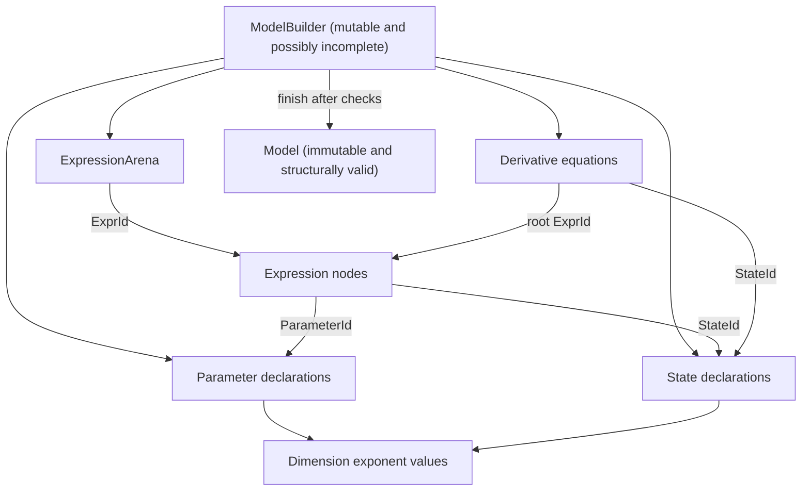

# Exercise 0001: Dimensions and model IR

## Exercise purpose

This milestone teaches the smallest structural ideas needed to represent a one-dimensional harmonic oscillator as source-independent model IR.
The repository provides the data shapes, public boundaries, numbered exercise holes, and behavioral tests.
You provide the reasoning that makes those shapes behave correctly.

The target model is:

```text
parameter mass: kg = 1.0
parameter stiffness: N/m = 4.0

state position: m = 1.0
state velocity: m/s = 0.0

derivative position = velocity
derivative velocity = -(stiffness / mass) * position
```

In mathematical form:

```text
x' = v
v' = -(k / m) x
```

This milestone stops after constructing an immutable structural representation.
It does not parse source text, infer expression dimensions, evaluate expressions, or simulate motion.

## How to use the scaffold

Normal validation should stay green while exercises are unfinished:

```sh
cargo fmt --all --check
cargo clippy --workspace --all-targets --all-features -- -D warnings
cargo test --workspace
cargo check --workspace
```

The behavioral exercise tests are ignored initially.
Run one named test with `--ignored --exact` while working on its TODO.
Before its implementation, that command should reach a numbered `todo!()` exercise hole and fail.

After an exercise behaves correctly, remove the corresponding `#[ignore]` attributes so the normal test suite protects it from regression.
Do not weaken an assertion to obtain a green result.

## Prerequisite concepts

Review these ideas before beginning:

- Rust structs and enums as closed data representations.
- Tuple structs as distinct newtypes.
- `Vec<T>` ownership, indexing, and borrowed slices.
- `Result<T, E>` for recoverable structural failures.
- Borrowing through `&self` and ownership transfer through `self`.
- Trait implementations, especially `Display`.
- Integration tests and ignored tests in Cargo.
- Integer exponent laws for products and quotients.
- The first-order form of an ordinary differential-equation system.

You do not need prior experience with parsers, numerical solvers, or automatic differentiation for this milestone.

## Representation map



The arena owns expressions, while graph edges carry `ExprId` values instead of Rust references.
The builder temporarily owns incomplete pieces, while a finished `Model` exposes only read-only accessors.

## Conceptual foundation

### Dimensions as exponent vectors

A physical dimension records how a quantity depends on the seven SI base dimensions.
An exponent vector gives one fixed position to mass, length, time, electric current, thermodynamic temperature, amount of substance, and luminous intensity.
For example, velocity has one length contribution and an inverse time contribution.

This representation is about semantic kinds of quantity rather than their display units.
The exercise is to make the representation obey the expected exponent laws without turning it into a unit-conversion system.

### Units and dimensions are different

Metres and kilometres are different named units with different scales, but both measure the physical dimension of length.
Kilograms and pounds are different named units for mass.
This milestone records only the common physical dimension and does not record a unit name, prefix, conversion factor, or offset.

### Products, quotients, and compatible addition

Multiplication and division form compound physical dimensions according to exponent laws.
That is how the same representation can describe velocity, acceleration, force, and stiffness.

Addition and subtraction have a different constraint.
Their operands must describe compatible physical dimensions because adding unlike physical quantities has no coherent meaning.
Unit conversion may be needed before adding two values expressed at different scales, but convertibility is separate from dimensional compatibility.

### Arenas and stable typed IDs

Compiler IR often owns graph nodes in an arena and stores edges as stable indices.
This avoids long-lived Rust references between nodes and leaves room for lookup, validation, rewriting, and serialization.

Typed newtypes prevent a `StateId`, `ParameterId`, and `ExprId` from being passed interchangeably even though each stores a `usize`.
Plain `usize` values would let the compiler accept cross-domain mistakes that should be impossible at the API boundary.

### Builders and valid immutable models

A builder can temporarily accept declarations and graph pieces while structural completeness is still being established.
Its finalization boundary is where incomplete or contradictory state must be rejected.
A completed `Model` can then stay immutable so downstream consumers do not need to defend against arbitrary mutation of its invariants.

Every state in an ordinary differential-equation model needs exactly one derivative equation.
A missing derivative leaves the state's evolution undefined, while duplicate derivatives make it ambiguous.

### Why this crate stops at structural IR

`stormer-ir` owns source-independent model structure.
Parser spans and terminal-facing diagnostics belong to `stormer-frontend`, where source text and error presentation are known.
Runtime state, expression values, and numerical integration belong to `stormer-runtime`, which consumes valid IR without depending on source syntax.

## Stage 1: Physical-dimension values

Work through TODOs 001 through 005 in order.
The later tests use the constructors and composition operations established by the earlier tests.

### TODO(STORMER-001): Dimension construction

**Responsibility and invariant**

Construct dimensionless values and individual base dimensions, then expose one selected exponent without losing the fixed seven-category shape.
Each base dimension must be independent from the other six.

**Questions before coding**

- What does every exponent contain for a dimensionless quantity?
- How will each `BaseDimension` variant identify one position without creating a unit registry?

**Ignored tests**

- `dimensionless_has_zero_exponents`
- `base_dimensions_are_independent`

**Run the first test**

```sh
cargo test -p stormer-ir --test dimensions dimensionless_has_zero_exponents -- --ignored --exact
```

### TODO(STORMER-002): Dimension multiplication

**Responsibility and invariant**

Compose two dimension values so the result describes the physical dimension of their product.
The operation should create a value without mutating either input.

**Questions before coding**

- Which exponent law describes the product of two physical quantities?
- What identity behavior should a dimensionless operand have?

**Ignored tests**

- `multiplication_composes_dimensions`
- `force_equals_mass_times_acceleration`

**Run the first test**

```sh
cargo test -p stormer-ir --test dimensions multiplication_composes_dimensions -- --ignored --exact
```

### TODO(STORMER-003): Dimension division

**Responsibility and invariant**

Compose two dimension values so the result describes the physical dimension of their quotient.
The representation must preserve negative exponents.

**Questions before coding**

- How does moving a physical quantity into the denominator affect its exponent contribution?
- What relationship should hold between division and multiplication by an inverse dimension?

**Ignored tests**

- `division_composes_dimensions`
- `velocity_equals_length_divided_by_time`

**Run the first test**

```sh
cargo test -p stormer-ir --test dimensions division_composes_dimensions -- --ignored --exact
```

### TODO(STORMER-004): Dimension compatibility

**Responsibility and invariant**

Decide whether two values describe the same physical dimension for addition, subtraction, or comparison.
Compatibility must be symmetric and independent of unit names or conversion scales.

**Questions before coding**

- Which stored facts make two dimension values semantically compatible?
- Why should metres and kilometres be compatible even though their numeric scales differ?

**Ignored tests**

- `equivalent_dimensions_are_compatible`
- `different_dimensions_are_incompatible`

**Run the first test**

```sh
cargo test -p stormer-ir --test dimensions equivalent_dimensions_are_compatible -- --ignored --exact
```

### TODO(STORMER-005): Canonical formatting

**Responsibility and invariant**

Produce deterministic text for a physical dimension so equal values always render identically.
The exercise tests define these first output examples:

```text
dimensionless  -> 1
velocity       -> L T^-1
force          -> M L T^-2
```

Use the stable base order `M`, `L`, `T`, `I`, `Theta`, `N`, `J`.
Zero exponents are omitted, and an exponent of one has no suffix.
These are formatting requirements, not an implementation algorithm.

**Questions before coding**

- How will dimensionless output remain unambiguous when every zero exponent is omitted?
- Which formatting cases deserve their own small tests if you discover an edge case?

**Ignored test**

- `dimension_formatting_is_canonical`

**Run the test**

```sh
cargo test -p stormer-ir --test dimensions dimension_formatting_is_canonical -- --ignored --exact
```

### Reflection checkpoint: Dimension values

- Why can force and energy not be added even though both use combinations of kilograms, metres, and seconds?
- Which parts of a future unit-conversion system must remain outside `Dimension`?
- What representation invariant became easiest to state once the vector length was fixed?

Write down your answers before continuing to expression storage.

## Stage 2: Typed expression arena

The expression enum already lists the only node shapes in this milestone.
Your task is to make owned storage and typed graph references structurally trustworthy.

### TODO(STORMER-006): Typed arena allocation

**Responsibility and invariant**

Store each expression and return a stable `ExprId` that continues to identify that node after later insertions.
The arena owns every stored expression.

**Questions before coding**

- Which stable property of the owned collection can serve as an index identity?
- What bugs would become possible if this API returned a plain `usize`?

**Ignored test**

- `arena_assigns_stable_expression_ids`

**Run the test**

```sh
cargo test -p stormer-ir --test expression_arena arena_assigns_stable_expression_ids -- --ignored --exact
```

### TODO(STORMER-007): Lookup and operand validation

**Responsibility and invariant**

Look up expression nodes without panicking on unavailable IDs and reject an arena whose operand edges cannot resolve.
Typed IDs prevent namespace confusion but do not guarantee that the stored index exists.

**Questions before coding**

- What error context makes a broken graph edge understandable?
- What should happen when an expression references an expression that has not been inserted yet?

**Forward-reference decision checkpoint**

Decide and document whether a structurally valid arena may contain an operand edge to a node that was inserted later.
One policy can require edges to point only to earlier nodes, while another can validate all edges against the completed arena.
The existing invalid-reference test is compatible with either policy because its operand never exists.
Add a focused behavioral test for the policy you choose before implementing it.

**Ignored tests**

- `arena_preserves_inserted_nodes`
- `arena_rejects_an_invalid_expression_id`
- `arena_detects_an_invalid_operand_reference`

**Run a focused test**

```sh
cargo test -p stormer-ir --test expression_arena arena_rejects_an_invalid_expression_id -- --ignored --exact
```

### Reflection checkpoint: Expression ownership

- Why does the graph store `ExprId` values instead of references to `Expression` values?
- Which validity facts are enforced by Rust's types, and which still need runtime structural checks?
- How would your forward-reference policy affect the claim that the expression graph is acyclic?

Do not assume that valid indices alone prove acyclicity.

## Stage 3: Checked model construction

The builder separates mutable assembly from the immutable representation exposed to later compiler and runtime stages.
Keep each structural check focused rather than hiding all validation behind one broad operation.

### TODO(STORMER-008): Parameter and state allocation

**Responsibility and invariant**

Store declarations in their own namespaces and allocate stable `ParameterId` and `StateId` values.
Declaration order must remain observable through the finalized model.

**Questions before coding**

- Why may a first parameter and a first state share the same numeric index safely?
- Should declarations preserve source order, semantic order, or both at this stage?

**Ignored test**

- `parameter_and_state_ids_are_distinct`

The later `builder_preserves_declaration_order` test checks that the chosen ordering survives finalization.

**Run the test**

```sh
cargo test -p stormer-ir --test model_construction parameter_and_state_ids_are_distinct -- --ignored --exact
```

### TODO(STORMER-009): Derivative target validation

**Responsibility and invariant**

Reject a derivative equation whose `StateId` is unavailable in the builder.
This is referential integrity over an existing declaration namespace, not source-language name resolution.

**Questions before coding**

- Which owned collection establishes whether the target exists?
- Why does a correctly typed `StateId` still need a bounds check?

**Ignored test**

- `builder_rejects_an_invalid_derivative_target`

**Run the test**

```sh
cargo test -p stormer-ir --test model_construction builder_rejects_an_invalid_derivative_target -- --ignored --exact
```

### TODO(STORMER-010): Duplicate derivative detection

**Responsibility and invariant**

Ensure that one state cannot receive more than one derivative equation.
The selected internal lookup should make the invariant understandable and preserve any ordering promised by the model.

**Questions before coding**

- Which representation makes it clear whether a state already has a derivative?
- What error context should identify the conflicting target?

**Ignored test**

- `builder_rejects_duplicate_derivatives`

**Run the test**

```sh
cargo test -p stormer-ir --test model_construction builder_rejects_duplicate_derivatives -- --ignored --exact
```

### TODO(STORMER-011): Missing derivative detection

**Responsibility and invariant**

Reject finalization if any state lacks a derivative equation.
This completeness check belongs at a boundary where the builder is expected to become a valid model.

**Questions before coding**

- Why is this check premature while the caller is still adding declarations?
- If several states are incomplete, which error should be returned first and why?

**Ignored test**

- `builder_rejects_states_without_derivatives`

**Run the test**

```sh
cargo test -p stormer-ir --test model_construction builder_rejects_states_without_derivatives -- --ignored --exact
```

### TODO(STORMER-012): Model finalization

**Responsibility and invariant**

Complete the individual structural checks and transfer ownership from `ModelBuilder` into an immutable `Model`.
Every parameter, state, expression operand, derivative target, and derivative root must resolve in its correct namespace.

**Questions before coding**

- Which checks belong before ownership moves, and which facts are already guaranteed by earlier methods?
- Why should a finalized `Model` have no general mutation methods?

**Ignored tests**

- `builder_preserves_declaration_order`
- `finalized_model_exposes_consistent_read_only_data`
- `builder_rejects_an_invalid_parameter_reference_during_finalization`
- `builder_rejects_an_invalid_state_reference_during_finalization`
- `builder_rejects_an_invalid_derivative_root_during_finalization`
- `builder_rejects_an_invalid_operand_during_finalization`

**Run the consistency test**

```sh
cargo test -p stormer-ir --test model_construction finalized_model_exposes_consistent_read_only_data -- --ignored --exact
```

### Reflection checkpoint: Model validity

- Which invariants belong in `stormer-ir`, and which belong in `stormer-frontend`?
- Why is a missing derivative a structural model problem rather than a numerical solver problem?
- What guarantee does immutability give the future runtime after finalization succeeds?

Record any new error cases as observable behavior before expanding the error enum.

## Stage 4: Harmonic-oscillator capstone

This stage uses the completed public API from the earlier exercises.
Do not add a production helper specifically for the oscillator.

### TODO(STORMER-013): Harmonic oscillator construction

**Responsibility and invariant**

Construct the two parameters, two states, expression graph, and two derivative equations for the target oscillator inside the ignored integration test fixture.
The completed model must contain valid typed references and preserve the mathematical structure of both first-order equations.
The tests specify declaration names, dimensions, initial values, derivative targets, and the expression topology for `x' = v` and `v' = -(k / m) x`.

**Questions before coding**

- How would the oscillator equation be represented as a directed acyclic expression graph?
- Which graph nodes refer to declarations, and which graph nodes refer to other expressions?
- Which subexpressions could be shared without changing the equation meaning?

**Ignored tests**

- `harmonic_oscillator_can_be_constructed_programmatically`
- `harmonic_oscillator_uses_two_states_and_two_parameters`
- `harmonic_oscillator_derivative_roots_reference_valid_expressions`

**Run the first test**

```sh
cargo test -p stormer-ir --test harmonic_oscillator harmonic_oscillator_can_be_constructed_programmatically -- --ignored --exact
```

### Reflection checkpoint: From equations to IR

- Which parts of the oscillator representation express physics, and which parts express graph structure?
- Where would dimensional inference over the expression graph belong in a later milestone?
- What information would a runtime need in addition to this immutable model before it could simulate motion?

The answers should reinforce why this milestone stops before evaluation or integration.

## Completion criteria

The milestone is complete only when:

- TODOs `STORMER-001` through `STORMER-013` have deliberate implementations written by the project owner.
- Every associated behavioral test passes without weakening its assertions.
- Completed tests are no longer ignored and run under `cargo test --workspace`.
- The chosen forward-reference policy is documented and protected by a focused test.
- Dimension formatting matches the specified canonical examples.
- Invalid expression and model references return the expected structural errors instead of panicking.
- The finalized model exposes consistent read-only data.
- The harmonic oscillator can be constructed through public IR APIs without a production-only shortcut.
- No parser, runtime evaluator, numerical solver, binding, or external dependency has been added.
- Formatting, Clippy, tests, and workspace checking all pass.

Finish with a short written reflection explaining which invariants Rust's type system enforces and which invariants require checked construction at runtime.
