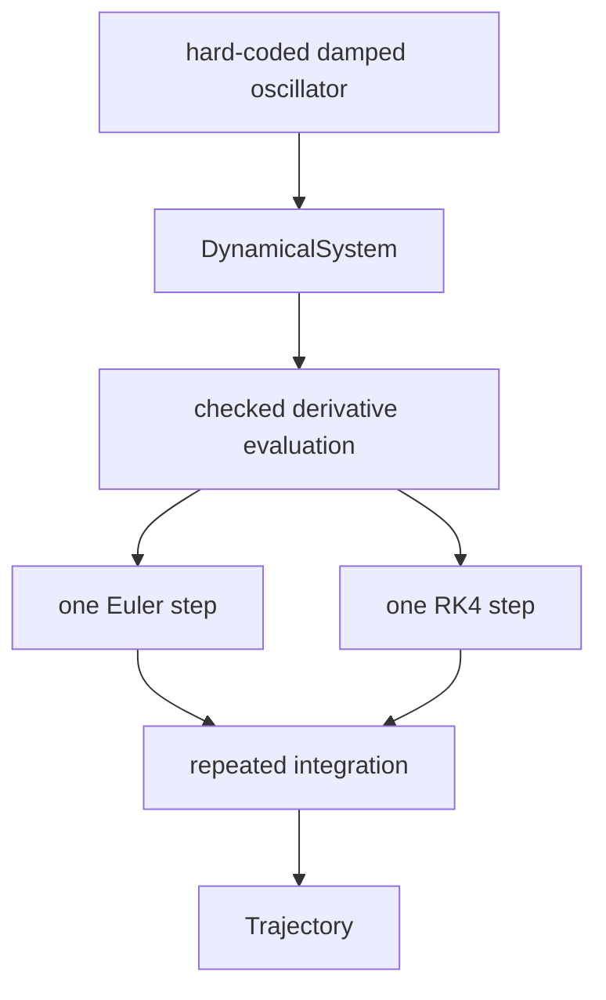

# Exercise 0002: Numerical runtime

## Exercise purpose

This exercise teaches how a first-order ordinary differential-equation system becomes a numerical trajectory.
It deliberately starts from a hard-coded system so parser, name-resolution, lowering, and interpreter defects cannot hide numerical mistakes.

The repository provides:

- A runtime-local `DynamicalSystem` contract.
- Structural runtime error types.
- Read-only trajectory shapes.
- Whole-operation TODO holes.
- Ignored behavioral specifications.

You provide the derivative validation, numerical stepping, repeated integration, and damped-oscillator reasoning.

## Canonical model

The capstone model is:

```text
m x'' + c x' + k x = 0
```

The runtime uses two first-order state slots in this fixed order:

```text
state[0] = position x
state[1] = velocity v
```

The corresponding state equations are recorded in `docs/learning-charter.md` and `docs/semantics.md`.
Deriving and implementing the derivative remains part of this exercise.

## Boundaries

This exercise includes:

- Checked derivative evaluation.
- One explicit Euler step.
- Repeated stepping into a trajectory.
- One classical RK4 step.
- Qualitative evidence for a damped oscillator.

This exercise excludes:

- `stormer-ir` evaluation.
- Source text, parsing, diagnostics, and lowering.
- Dimension inference.
- Adaptive time stepping.
- Solver framework abstractions.
- Calibration and automatic differentiation.

The runtime crate already depends on `stormer-ir` for the future architecture, but this exercise must not use IR types.

## Relevant files

```text
crates/stormer-runtime/src/error.rs
crates/stormer-runtime/src/system.rs
crates/stormer-runtime/src/integration.rs
crates/stormer-runtime/src/trajectory.rs
crates/stormer-runtime/tests/runtime_contract.rs
crates/stormer-runtime/tests/euler.rs
crates/stormer-runtime/tests/trajectory.rs
crates/stormer-runtime/tests/rk4.rs
crates/stormer-runtime/tests/damped_oscillator.rs
```

## How to use the scaffold

Normal validation stays green while all runtime exercises are unfinished:

```sh
cargo fmt --all --check
cargo clippy --workspace --all-targets --all-features -- -D warnings
cargo test --workspace
cargo check --workspace
```

Run one named ignored test while working on its TODO.
Before implementation, the test should reach the corresponding `todo!()` and fail.

After an exercise is correct, remove only its matching `#[ignore]` attributes.
Do not weaken an assertion or add a second implementation in test support code.

## Concepts to review first

- A first-order ODE as a function from time and current state to a state derivative.
- Why a second-order equation needs more than one first-order state slot.
- The geometric meaning of a derivative as a local slope.
- Local truncation error and accumulated global error.
- Numerical stability and the role of step size.
- Ownership and borrowing of slices and vectors in Rust.
- `Result<T, E>` for explicit precondition failures.
- Why an analytical solution can provide independent numerical evidence.

## Contract map



## TODO(STORMER-014): Checked derivative evaluation

### Goal

Turn a system callback into one validated derivative vector that every stepper can trust.

### Required invariants

- The system dimension is not zero.
- The supplied state length equals the system dimension.
- Time and every state value are finite.
- The returned derivative length equals the system dimension.
- Every derivative value is finite.
- Validation and evaluation do not mutate the caller's state.

### Behavioral tests

- `empty_system_is_reported_before_evaluation`
- `wrong_state_dimension_is_reported`
- `wrong_derivative_dimension_is_reported`
- `non_finite_time_is_reported`
- `non_finite_state_is_reported`
- `non_finite_derivative_is_reported`

### First command

```sh
cargo test -p stormer-runtime --test runtime_contract wrong_state_dimension_is_reported -- --ignored --exact
```

### Hints

<details>
<summary>Level 1: Conceptual</summary>

Treat the system's declared dimension as a contract shared by input state and output derivative.
Validate facts at the boundary where they become knowable.

</details>

<details>
<summary>Level 2: Structural</summary>

Separate checks that can happen before the callback from checks that require its returned vector.
Return the first precise `RuntimeError` rather than indexing an invalid vector.

</details>

<details>
<summary>Level 3: Local</summary>

Rust's `f64::is_finite` distinguishes ordinary values from NaN and infinities.
An iterator position can identify the first invalid state or derivative entry.

</details>

### Reflection

- Why is a typed Rust vector still capable of having the wrong system dimension?
- Which invariant can the compiler enforce here, and which remains dynamic?
- Why should every stepper share this checked boundary?

## TODO(STORMER-015): One explicit Euler step

### Goal

Advance a valid state by one explicit Euler step without mutating the input.

### Required invariants

- Time, step size, state, and derivative satisfy the runtime contract.
- The step size is finite and positive.
- The result has exactly one value per state slot.
- Each output component uses the matching state and derivative component.
- The input vector remains unchanged.

### Behavioral tests

- `euler_step_matches_constant_derivative`
- `euler_step_does_not_mutate_its_input`
- `euler_step_rejects_a_non_positive_step_size`
- `euler_step_rejects_a_non_finite_step_size`

### First command

```sh
cargo test -p stormer-runtime --test euler euler_step_matches_constant_derivative -- --ignored --exact
```

### Hints

<details>
<summary>Level 1: Conceptual</summary>

Euler uses the derivative at the beginning of the step as a local approximation to how the state changes across that step.

</details>

<details>
<summary>Level 2: Structural</summary>

Obtain one checked derivative vector, then construct a new state vector component by component.
Keep evaluation separate from state construction.

</details>

<details>
<summary>Level 3: Local</summary>

Pair state and derivative entries only after both lengths are known to match.
Use the step size to scale each local change without writing into the borrowed input slice.

</details>

### Reflection

- Which point in time supplies Euler's slope?
- Why is the result an approximation even when the derivative callback is exact?
- What numerical behavior do you expect when the step is too large for an oscillator?

## TODO(STORMER-016): Repeated integration and trajectory construction

### Goal

Apply a selected step repeatedly and retain an inspectable sequence of time-state pairs.

### Required invariants

- Start time, end time, step size, and initial state pass validation before stepping.
- The first sample equals the exact initial condition at the exact start time.
- Sample times increase monotonically.
- Every sample owns one complete state vector in stable order.
- The integration method selects only the two methods approved for this milestone.
- An invalid request returns an error rather than a partial trajectory.

### Behavioral tests

- `trajectory_begins_with_the_initial_condition`
- `integration_rejects_a_non_positive_step_size`
- `integration_rejects_a_reversed_interval`
- `integration_rejects_a_non_finite_start_time`
- `integration_rejects_a_non_finite_end_time`
- `integration_rejects_a_non_finite_step_size`
- `integration_validates_the_initial_state_before_stepping`
- `integration_rejects_a_non_finite_initial_state`

### First command

```sh
cargo test -p stormer-runtime --test trajectory trajectory_begins_with_the_initial_condition -- --ignored --exact
```

### Decision before coding

Choose what happens when the interval length is not an exact multiple of the requested step size.
The initial options are to reject the interval or take one shorter final step.
Record the choice in `docs/semantics.md` and add one focused ignored test before completing this TODO.

### Hints

<details>
<summary>Level 1: Conceptual</summary>

A trajectory is evidence about a sequence of accepted numerical states, not just the final vector.
Its first sample anchors every later comparison to the stated initial condition.

</details>

<details>
<summary>Level 2: Structural</summary>

Validate the complete request first.
Own the current state locally, record it, advance it through the selected step function, then record subsequent accepted states.

</details>

<details>
<summary>Level 3: Local</summary>

Keep time and state in one `TrajectorySample` so parallel collections cannot drift apart.
Make the final-step policy explicit in the loop condition instead of relying on floating-point equality.

</details>

### Reflection

- Why must the initial condition be part of the trajectory rather than separate metadata?
- Which loop condition is vulnerable to floating-point assumptions?
- What information would another person need to reproduce the trajectory?

## TODO(STORMER-017): One classical RK4 step

### Goal

Advance one state with classical RK4 and compare its error behavior with Euler on a known system.

### Required invariants

- Every intermediate derivative uses the checked evaluation boundary.
- Intermediate states have the complete system dimension.
- The final result is a new vector, and the input remains unchanged.
- Time and state offsets correspond to the classical four-stage method.
- Tests compare against an independent analytical value rather than a copy of the implementation.

### Behavioral tests

- `rk4_step_matches_a_linear_reference`
- `halving_rk4_step_reduces_error`
- `rk4_step_does_not_mutate_its_input`
- `rk4_step_rejects_a_non_positive_step_size`
- `rk4_step_rejects_a_non_finite_step_size`

### First command

```sh
cargo test -p stormer-runtime --test rk4 rk4_step_matches_a_linear_reference -- --ignored --exact
```

### Hints

<details>
<summary>Level 1: Conceptual</summary>

RK4 samples several local slopes across the interval so one slope does not stand in for the entire step.

</details>

<details>
<summary>Level 2: Structural</summary>

Name the four derivative stages and the temporary state used for each stage.
Keep stage construction separate so time offsets and state offsets can be reviewed independently.

</details>

<details>
<summary>Level 3: Local</summary>

The classical method samples at the beginning, two midpoint estimates, and the end.
Check the standard RK4 stage weights against your numerical-method notes before encoding them.

</details>

### Reflection

- Why are the two midpoint stages not necessarily equal?
- What does halving the step reveal about error that one passing reference value does not?
- Why can RK4 still become unreliable with a poor step size?

## TODO(STORMER-018): Damped oscillator capstone

### Goal

Implement the canonical oscillator's derivative through `DynamicalSystem` and use the completed runtime to inspect damping behavior.

### Required invariants

- State slot 0 is position and state slot 1 is velocity.
- The provided capstone cases use finite parameters and strictly positive mass.
- The derivative result follows the same state order.
- The oscillator implementation contains model physics but no stepping algorithm.

### Deferred invalid-parameter policy

The scaffold does not yet define how a hard-coded system reports invalid model parameters.
Do not invent a misleading `RuntimeError` for zero mass or non-finite oscillator parameters.
Before accepting those inputs into the exercise scope, choose the validation boundary, extend the error contract, and add focused ignored tests.

### Behavioral tests

- `damped_oscillator_uses_position_then_velocity`
- `positive_damping_reduces_mechanical_energy`

### First command

```sh
cargo test -p stormer-runtime --test damped_oscillator damped_oscillator_uses_position_then_velocity -- --ignored --exact
```

### Hints

<details>
<summary>Level 1: Conceptual</summary>

Introduce velocity as the derivative of position, then isolate acceleration in the original second-order equation.

</details>

<details>
<summary>Level 2: Structural</summary>

Write down the meaning and derivative of each state slot before writing Rust.
Keep parameter validation distinct from the two derivative components.

</details>

<details>
<summary>Level 3: Local</summary>

Evaluate the derivative at position 1 and velocity 0 by hand for the parameters used in the first test.
Use that calculation to check signs and slot order before running a trajectory.

</details>

### Reflection

- Why does positive damping reduce mechanical energy?
- Which sign error would turn damping into energy injection?
- Which qualitative checks distinguish underdamped, critically damped, and overdamped behavior?
- Why does a correct derivative not guarantee a correct trajectory?

## Completion criteria

This exercise is complete only when:

1. TODOs 014 through 018 are implemented by the learner.
2. Their matching ignore markers are removed.
3. The non-divisible-interval policy is documented and tested.
4. Runtime errors are returned for every specified invalid shape and non-finite execution input.
5. Euler and RK4 pass independently justified reference tests.
6. The oscillator trajectory demonstrates the expected damping behavior with documented numerical settings.
7. Normal workspace validation passes.
8. The learner can answer every reflection section without relying only on code execution.

## Debrief checklist

Before moving to expressions and dimensions, write down:

- The meaning and order of every oscillator state slot.
- The derivative function in mathematical notation and plain language.
- The contract shared by derivative evaluation and both steppers.
- One observed Euler error and one observed stability failure.
- How RK4 error changed when the step was halved.
- The final-step policy and why it was selected.
- One abstraction deliberately deferred until a later milestone.
